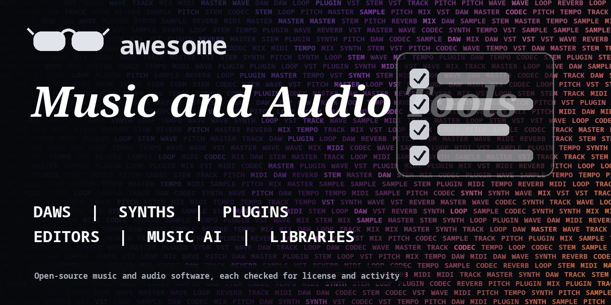

<h1 align="center">Awesome Music and Audio Tools</h1>

> Open-source DAWs, synths, audio editors, plugins, music AI, transcription and audio programming libraries. Every entry shows its license.

**Rules of this list:** every repo exists, is public, is not archived, states a license and has had a commit in the last year. One plain sentence each. Star counts and claims are the authors' own, we did not test every tool. Checked 2026-10-18. See [CONTRIBUTING.md](CONTRIBUTING.md).

## Contents

- [DAWs and editors](#daws-and-editors)
- [Synths, samplers and drum machines](#synths-samplers-and-drum-machines)
- [Plugins and effects](#plugins-and-effects)
- [Live coding and generative music](#live-coding-and-generative-music)
- [Music and audio AI](#music-and-audio-ai)
- [Audio programming libraries](#audio-programming-libraries)
- [Notation and scores](#notation-and-scores)
- [Podcast and streaming](#podcast-and-streaming)
- [How to choose](#how-to-choose)
- [Contributing](#contributing)

## DAWs and editors

Record, edit and mix.

- [Ardour/ardour](https://github.com/Ardour/ardour)  - Digital audio workstation for recording, editing and mixing. _(check repo)_
- [audacity/audacity](https://github.com/audacity/audacity)  - Free, cross-platform audio editor and recorder. _(check repo)_
- [LMMS/lmms](https://github.com/LMMS/lmms)  - Cross-platform music production software. _(GPL-2.0)_
- [Tracktion/tracktion_engine](https://github.com/Tracktion/tracktion_engine)  - Open-source audio engine for building DAWs. _(check repo)_
- [zrythm/zrythm](https://github.com/zrythm/zrythm)  - Highly automated, modern digital audio workstation. _(check repo)_

## Synths, samplers and drum machines

Make sounds.

- [BespokeSynth/BespokeSynth](https://github.com/BespokeSynth/BespokeSynth)  - Software modular synth for live and experimental music. _(GPL-3.0)_
- [DISTRHO/Cardinal](https://github.com/DISTRHO/Cardinal)  - Virtual modular synthesizer plugin. _(GPL-3.0)_
- [surge-synthesizer/surge](https://github.com/surge-synthesizer/surge)  - Free and open-source hybrid synthesizer. _(GPL-3.0)_
- [VCVRack/Rack](https://github.com/VCVRack/Rack)  - Open-source virtual modular synthesizer. _(check repo)_

## Plugins and effects

VST3, CLAP and LV2.

- [calf-studio-gear/calf](https://github.com/calf-studio-gear/calf)  - Set of open-source audio plugins. _(LGPL-2.1)_
- [free-audio/clap](https://github.com/free-audio/clap)  - CLAP audio plugin standard. _(MIT)_
- [juce-framework/JUCE](https://github.com/juce-framework/JUCE)  - Cross-platform C++ framework for audio apps and plugins. _(check repo)_
- [lv2/lv2](https://github.com/lv2/lv2)  - Extensible audio plugin standard. _(ISC)_
- [steinbergmedia/vst3sdk](https://github.com/steinbergmedia/vst3sdk)  - VST 3 plugin SDK. _(MIT)_

## Live coding and generative music

Code that makes music.

- [overtone/overtone](https://github.com/overtone/overtone)  - Collaborative programmable music. _(check repo)_
- [sonic-pi-net/sonic-pi](https://github.com/sonic-pi-net/sonic-pi)  - Code-based music creation and performance tool. _(check repo)_
- [supercollider/supercollider](https://github.com/supercollider/supercollider)  - Platform for audio synthesis and algorithmic composition. _(GPL-3.0)_

## Music and audio AI

Separation, transcription and generation. Check model licenses.

- [deezer/spleeter](https://github.com/deezer/spleeter)  - Music source separation library with pretrained models. _(MIT)_
- [facebookresearch/audiocraft](https://github.com/facebookresearch/audiocraft)  - Library for audio and music generation research. Check model licenses. _(MIT)_
- [openai/whisper](https://github.com/openai/whisper)  - General-purpose speech recognition model. _(MIT)_
- [spotify/basic-pitch](https://github.com/spotify/basic-pitch)  - Lightweight audio to MIDI converter. _(Apache-2.0)_

## Audio programming libraries

DSP and audio I/O.

- [FFmpeg/FFmpeg](https://github.com/FFmpeg/FFmpeg)  - Mirror of the FFmpeg multimedia framework. _(check repo)_
- [jiaaro/pydub](https://github.com/jiaaro/pydub)  - Manipulate audio with a simple, easy high-level interface. _(MIT)_
- [librosa/librosa](https://github.com/librosa/librosa)  - Python package for music and audio analysis. _(ISC)_
- [mackron/miniaudio](https://github.com/mackron/miniaudio)  - Single-file audio playback and capture library. _(check repo)_
- [mido/mido](https://github.com/mido/mido)  - MIDI objects for Python. _(MIT)_
- [MTG/essentia](https://github.com/MTG/essentia)  - C++ library for audio and music analysis. _(AGPL-3.0)_
- [spatialaudio/python-sounddevice](https://github.com/spatialaudio/python-sounddevice)  - Play and record sound with Python. _(MIT)_
- [Tonejs/Tone.js](https://github.com/Tonejs/Tone.js)  - Web Audio framework for interactive music in the browser. _(MIT)_
- [xiph/opus](https://github.com/xiph/opus)  - Modern audio codec. _(check repo)_

## Notation and scores

Write and engrave music.

- [lilypond/lilypond](https://github.com/lilypond/lilypond)  - Music engraving program. _(check repo)_
- [musescore/MuseScore](https://github.com/musescore/MuseScore)  - Open-source music notation software. _(check repo)_
- [opensheetmusicdisplay/opensheetmusicdisplay](https://github.com/opensheetmusicdisplay/opensheetmusicdisplay)  - Render MusicXML in the browser. _(BSD-3-Clause)_

## Podcast and streaming

Record and publish.

- [AzuraCast/AzuraCast](https://github.com/AzuraCast/AzuraCast)  - Self-hosted web radio management suite. _(AGPL-3.0)_
- [libretime/libretime](https://github.com/libretime/libretime)  - Open-source radio broadcasting software. _(AGPL-3.0)_
- [mixxxdj/mixxx](https://github.com/mixxxdj/mixxx)  - Free DJ software. _(check repo)_

## How to choose

- **Check sample and model licenses.** Free software does not mean free samples.
- **Keep project backups.**
- **Check plugin formats** (VST3, CLAP, AU) against your DAW.
- **Check the license.**

## Contributing

See [CONTRIBUTING.md](CONTRIBUTING.md). One entry per pull request, plain words, real sources only.

## About

Maintained by [@devanasolver](https://github.com/devanasolver). Listings follow the rules in CONTRIBUTING.

## Sponsor me

If this list is useful, [buy me a coffee](https://buymeacoffee.com/isaac49).
